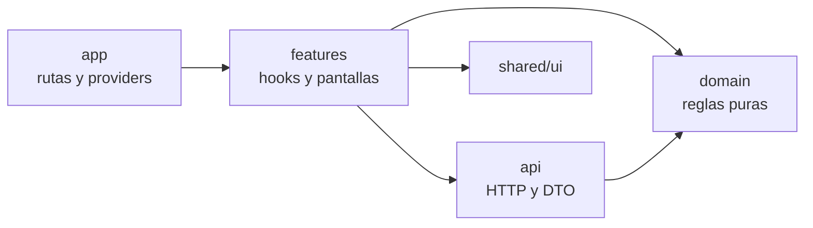

# Arquitectura

Cómo está organizado el código y por qué. Las decisiones de producto (qué hace la app frente a cada ambigüedad de la consigna) están en [`DECISIONS.md`](DECISIONS.md); acá está **dónde vive cada una y cómo fluyen los datos**.

## Capas

```
src/domain/     reglas de negocio puras (TypeScript, sin dependencias)
src/api/        cliente HTTP, validación y conversión de respuestas, errores normalizados
src/features/   hooks y pantallas por funcionalidad (session, accounts, movements, transfers, fx, toast, demo)
src/shared/ui/  componentes de presentación genéricos: solo props, sin datos
src/app/        providers, rutas, layout y composición de servicios
```



Las dependencias van en un solo sentido: hacia el dominio. **`src/domain` no puede importar React, TanStack Query, React Router ni ninguna otra capa**; una regla de ESLint (`no-restricted-imports` en [`eslint.config.js`](eslint.config.js)) falla el lint si alguien lo intenta. Los tipos y formatos de la API tampoco salen de `src/api`.

## Dónde vive cada decisión

Cada regla de negocio es una función pura del dominio, con sus tests al lado. Las pantallas y los hooks la llaman; no la reimplementan.

| Decisión | Función | Archivo |
|---|---|---|
| Multi-moneda: bloquear entre monedas distintas | `canTransferBetween` | [`currency.ts`](src/domain/currency.ts) |
| Multi-moneda: equivalencia estimada y total en ARS | `convert`, `estimatedTotalArs` | [`fx.ts`](src/domain/fx.ts) |
| Estado asíncrono: cuándo consultar y cuándo cortar | `nextPoll`, `listShouldRefresh` | [`transferStatus.ts`](src/domain/transferStatus.ts) |
| Fondos: disponible = saldo − pendientes salientes | `accountFigures` | [`balances.ts`](src/domain/balances.ts) |
| Fondos: si se puede debitar (gastos y transferencias) | `canDebit` | [`funds.ts`](src/domain/funds.ts) |
| Qué se puede editar de un movimiento | `editableFields`, `editBlockReason` | [`editability.ts`](src/domain/editability.ts) |
| Montos en centavos, parseo y formato es-AR | `parseAmount`, `toCents`, `formatMoney` | [`money.ts`](src/domain/money.ts) |
| Validación del formulario de transferencia | `validateTransfer` | [`transferForm.ts`](src/domain/transferForm.ts) |

El dominio devuelve **códigos**, no textos (por ejemplo `{ reason: 'currencyMismatch', from: 'ARS', to: 'USD' }`). Cada funcionalidad los traduce a su copy en español, así que cambiar un mensaje no toca una regla, y viceversa.

## Flujo de datos

Ejemplo: confirmar una transferencia.

1. **Pantalla** (`features/transfers/TransferPage.tsx`): el formulario llama a `validateTransfer` con lo escrito y las cuentas. Si pasa, muestra la revisión.
2. **Hook** (`useCreateTransfer`): vuelve a aplicar `canDebit` con el disponible actual, porque pudo cambiar desde la revisión, y recién después llama a la API.
3. **API** (`api/endpoints.ts`): convierte centavos a decimales, hace el `POST`, valida la respuesta y la convierte a tipos del dominio. Cualquier fallo sale como un `ApiError` con un tipo.
4. **Seguimiento** (`useTransferStatus`): consulta el estado cada vez que `nextPoll` lo indica y deja de consultar cuando la función dice que terminó (acreditada, demorada o fallida).
5. **Caché**: al terminar, se refrescan cuentas, pendientes y movimientos, y todas las pantallas que los muestran se actualizan.

## Estado

| Tipo de estado | Dónde vive | Por qué |
|---|---|---|
| Datos del servidor (cuentas, movimientos, transferencias, cotizaciones) | TanStack Query | Caché, polling, reintentos y refresco sin código propio |
| Filtros, búsqueda y página de Movimientos | La URL | Sobreviven a una recarga y se pueden compartir |
| Sesión | Un store chico fuera de React, guardado en `sessionStorage` | Sobrevive a una recarga y se borra al cerrar la pestaña |
| Formularios y pasos de una pantalla | Estado local del componente | Nadie más lo necesita |
| Tema visual | `localStorage` | Preferencia del usuario, sin valor de negocio |

No hay un store global: casi todo el estado es del servidor, y lo demás es local o va en la URL. Por eso elegí React con TanStack Query en lugar de TypeScript sin framework con Zustand: el problema era sincronizar datos del servidor, no compartir estado del cliente.

La API se arma una sola vez en [`app/services.ts`](src/app/services.ts) y llega a las funcionalidades por un contexto (`WalletApiContext`). Los tests usan ese contexto para inyectar una API falsa en memoria. El panel de demostración, en cambio, intercepta el `fetch` que recibe el cliente, así que cada fallo simulado pasa por el cliente, la conversión de errores y los reintentos reales. Ninguno de los dos toca las pantallas.

## Errores

- **Un solo tipo de error.** `src/api/errors.ts` convierte cada respuesta en un `ApiError` con uno de estos tipos: `validation` y `badRequest` (400), `unauthorized` (401), `notFound` (404), `insufficientFunds` (422), `server` (5xx o una respuesta en la que no se puede confiar) y `network`. El cuerpo de la respuesta nunca se muestra.
- **Cada pantalla elige su texto** según el tipo. Por ejemplo, un 422 en una transferencia muestra el disponible actualizado; un 404 dice que la cuenta destino no existe.
- **401** con sesión iniciada: se cierra la sesión y se vuelve al login.
- **Reintentos:** las consultas se reintentan una vez ante `network` o `server`, nunca ante un 4xx. Las operaciones que mueven dinero no se reintentan nunca, y sin conexión fallan en vez de quedar en espera.
- **Fallar cerrado:** si el disponible no se puede calcular, los débitos se bloquean.

## Tests

| Capa | Qué se prueba | Cómo |
|---|---|---|
| `domain` | Las reglas de negocio | Tests unitarios puros, sin mocks |
| `api` | Conversión de montos, errores y validación de respuestas | Con un `fetch` simulado |
| `app` | Política de reintentos y modo sin conexión | Contando requests reales a un `fetch` simulado |
| `features` | Flujos críticos: doble envío, 422, seguimiento, 404, error de red, gasto sobre el disponible | Pantallas y hooks con una API falsa en memoria |

Ningún test necesita la API real ni un navegador. `npm test` corre los 358 tests en unos segundos.

## Si cambiara el framework o la librería de estado

- **Se mantiene igual:** `src/domain` (todas las reglas y sus tests) y `src/api` (cliente, conversión y errores). Ninguno de los dos conoce React.
- **Se reescribe:** `src/features`, `src/shared/ui` y `src/app`, que son la parte de presentación y conexión.
- Cambiar TanStack Query por otra librería afecta solo a los hooks de `src/features`: las decisiones de cuándo consultar o si se puede debitar siguen en el dominio.

## Especificaciones

El comportamiento se especificó antes de implementarlo con OpenSpec, en [`openspec/changes/`](openspec/changes/): `wallet-core` (sesión, cuentas, movimientos), `transfers` (transferencias, seguimiento y cotización) y `demo-panel` (simulación de fallos). Cada change tiene sus requisitos con escenarios, un `design.md` con las decisiones de implementación y las tareas.
