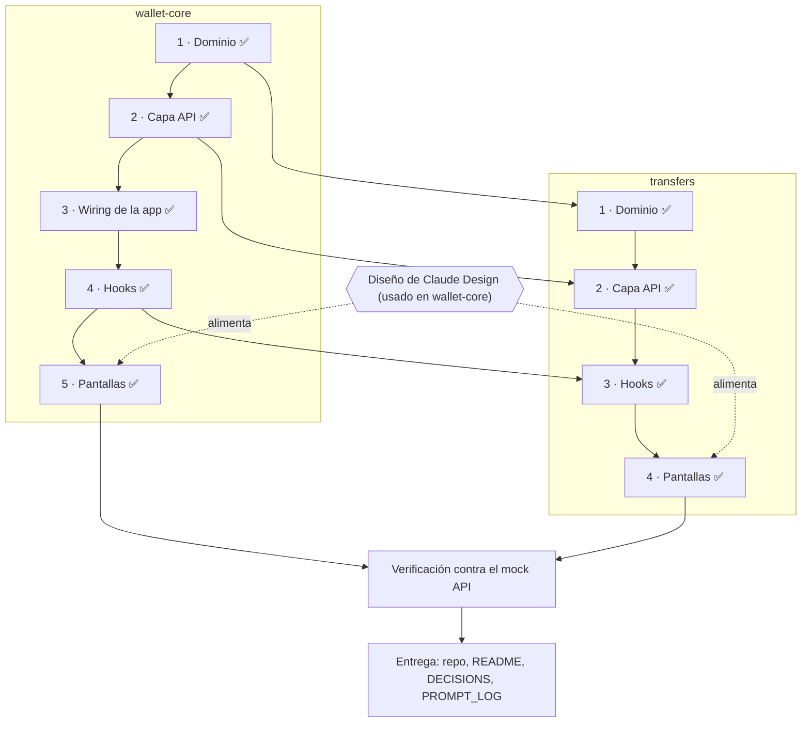
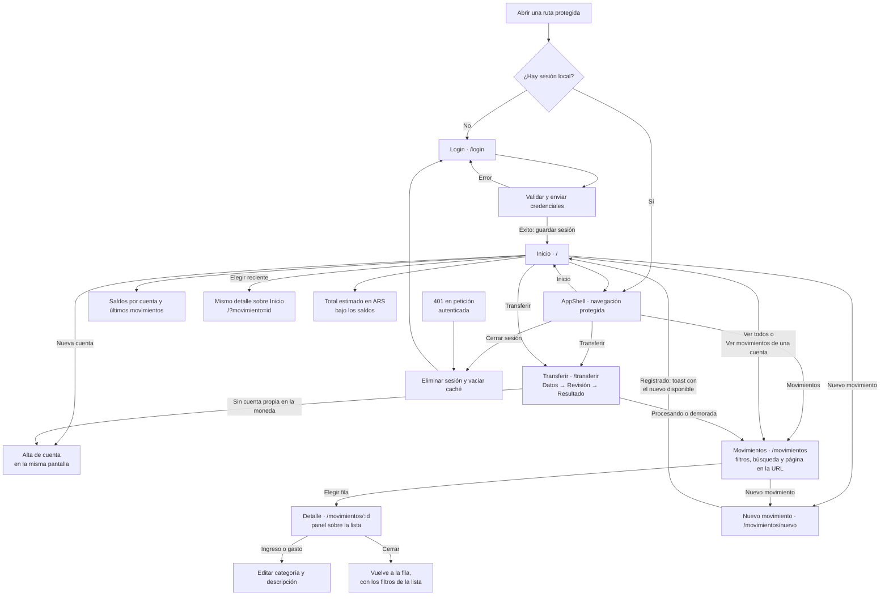
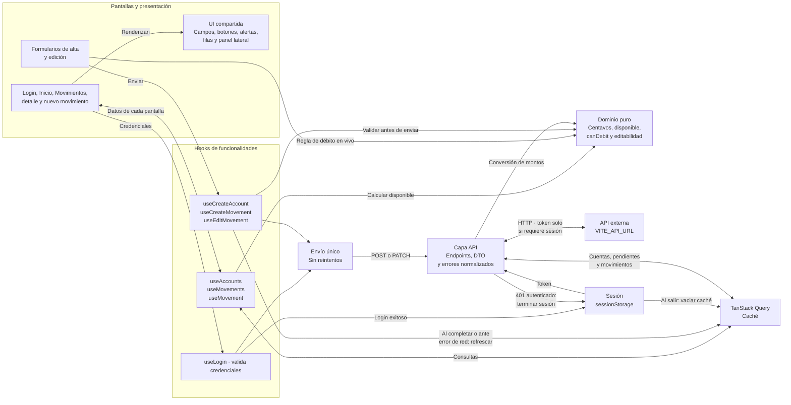
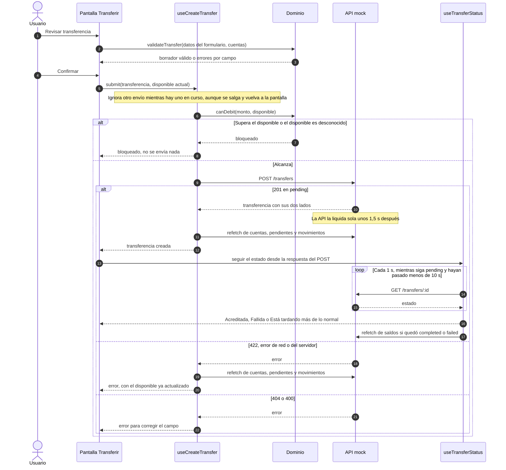

# Plan de trabajo — Billetera

> Actualizado el 7 de noviembre de 2026.
> El detalle de cada tarea vive en `openspec/changes/*/tasks.md`; este archivo es el mapa general.

## Avance

| Parte | Avance | Hechas |
|---|---|---|
| **wallet-core** (sesión, cuentas, movimientos) | `██████████` 100 % | 26 de 26 |
| **transfers** (transferencias, estados, cotización) | `██████████` 100 % | 17 de 17 |
| **demo-panel** (simulación de errores) | `███████░░░` 78 % | 7 de 9 |
| **Total** | `█████████░` 96 % | 50 de 52 |

wallet-core está completo, incluido el selector de temas y los ajustes de Inicio.

transfers está completo: dominio, capa API, hooks, pantallas y verificación.

demo-panel está integrado; quedan los dos recorridos manuales (4.2 y 4.3).

Los entregables escritos están listos: README, DECISIONS, PROMPT_LOG y ARCHITECTURE.

## Recorrido

**Leyenda:** ✅ listo · las flechas punteadas marcan lo que sale del diseño.

## Flujo actual de la app

Este flujo describe la navegación implementada, no el orden de desarrollo.

**Lectura:** el estado local permite entrar; si la API responde 401 a una petición autenticada, la app termina la sesión. Un 401 durante el login se muestra como error de credenciales. Iniciar sesión lleva a Inicio; con una sesión existente se conserva la ruta protegida solicitada. Una ruta desconocida redirige a Inicio y pasa por la misma protección.

El detalle es una ruta hija de Movimientos: la lista queda montada debajo y, al cerrar, el foco vuelve a la fila. Desde Inicio, el mismo panel se abre sobre Inicio (`?movimiento=`), sin cambiar de pantalla. Un gasto que supera el disponible (o con el disponible desconocido) no se puede enviar.

**Referencias:** [rutas](../src/app/routes.tsx), [Movimientos](../src/features/movements/MovementsPage.tsx), [detalle](../src/features/movements/MovementDetail.tsx), [nuevo movimiento](../src/features/movements/NewMovementPage.tsx), [Inicio](../src/features/accounts/HomePage.tsx), [Transferir](../src/features/transfers/TransferPage.tsx) y [sesión y cliente HTTP](../src/app/services.ts).

## Arquitectura e interacción actuales

Las flechas indican solicitudes, resultados o uso de una regla. El dominio es TypeScript puro: no consulta la API ni conoce React. El diagrama resume las interacciones relevantes; no es un inventario de todos los imports.

**Lectura:** Inicio, Movimientos y Nuevo movimiento piden las cuentas y las transferencias pendientes para calcular el disponible. Mientras los pendientes sean desconocidos, el disponible también lo es y la regla de dominio bloquea los gastos. La capa API transforma los montos entre decimales y centavos y normaliza los errores antes de devolverlos a las funcionalidades.

Los formularios de alta de cuenta (en Inicio), alta de movimiento y edición (en el detalle) usan esos hooks: validan con el dominio, evitan el doble envío e invalidan las consultas al completar. Ante un error de red se refrescan las consultas y se pide revisar antes de reintentar, porque la operación pudo haberse registrado. La pantalla Transferir usa los hooks de envío y seguimiento del estado, y la de cotizaciones para las estimaciones; Inicio usa las cotizaciones para el total estimado en ARS.

**Referencias:** [providers](../src/app/providers.tsx), [cuentas](../src/features/accounts/useAccounts.ts), [mutaciones](../src/features/useSingleSubmitMutation.ts), [refresco de consultas](../src/features/refreshMoneyQueries.ts), [endpoints](../src/api/endpoints.ts) y [reglas del dominio](../src/domain/).

## Secuencia de una transferencia

Diagrama de secuencia del envío y el seguimiento, tal como lo resuelven la pantalla, los hooks y el dominio.

**Lectura:** el dominio decide y los hooks ejecutan. El disponible se vuelve a comprobar al confirmar, porque pudo cambiar desde que se validó el formulario. Ningún error reenvía la transferencia sola: ante un error de red o del servidor se refrescan los datos para ver si se registró igual.

**Referencias:** [envío](../src/features/transfers/useCreateTransfer.ts), [seguimiento](../src/features/transfers/useTransferStatus.ts), [reglas del seguimiento](../src/domain/transferStatus.ts) y [validación del formulario](../src/domain/transferForm.ts).

## wallet-core

| # | Grupo | Qué incluye | Estado |
|---|---|---|---|
| 1 | Dominio | Montos, saldos (disponible y en proceso), regla de débito, editabilidad, categorías, etiquetas de transferencias | ✅ Listo |
| 2 | Capa API | Cliente HTTP, errores normalizados, endpoints con conversión a centavos; probada contra el mock API real | ✅ Listo |
| 3 | Wiring de la app | Sesión, política de reintentos, router con rutas protegidas, filtros en la URL | ✅ Listo |
| 4 | Hooks | Cuentas (falla cerrada), movimientos con filtros y paginación, altas y ediciones, login | ✅ Listo |
| 5 | Pantallas | 1ª entrega: base, shell, login e inicio. 2ª entrega: movimientos, detalle y edición, nuevo movimiento y nueva cuenta | ✅ Listo |
| 6 | Verificación | Gate de integración en verde (305 tests) y prueba manual con `demo@example.com` | ✅ Listo |
| 7 | Apariencia | Selector de temas junto al perfil, preferencia local y geometría de tarjetas conservada | ✅ Listo |

## transfers

| # | Grupo | Qué incluye | Estado |
|---|---|---|---|
| 1 | Dominio | Bloqueo entre monedas, estado de la transferencia (polling con tope), validación del formulario, cotización estimada | ✅ Listo |
| 2 | Capa API | Crear y consultar transferencias, cliente de cotizaciones | ✅ Listo |
| 3 | Hooks | Envío sin doble submit, seguimiento del estado, refresco de la lista, cotizaciones | ✅ Listo |
| 4 | Pantallas | Formulario, revisión con avisos P2P, resultado, total estimado | ✅ Listo |
| 5 | Verificación | Gate completo (316 tests) y prueba manual: propia, P2P, 422, 404, doble clic, trabada en pending, sin conexión y cotización caída | ✅ Listo |

## Entregables

| Entregable | Estado |
|---|---|
| `README.md` (qué es, cómo correr la API y la app, panel de demostración) | ✅ En `main` |
| `DECISIONS.md` (los tres puntos ambiguos, centavos y sin reintentos, qué no se implementó) | ✅ En `main` |
| `PROMPT_LOG.md` (uso de IA) | ✅ En `main` |
| `ARCHITECTURE.md` (capas, dónde vive cada regla, estado, errores y tests) | ✅ En `main` (bonus) |
| Agentes revisores `product-owner` y `security-gate` | ✅ Versionados en `.claude/agents/` |

## Bloqueos

Ninguno.

## Orden recomendado

1. ~~wallet-core · capa API (2) y wiring (3)~~ ✅
2. ~~wallet-core · hooks (4)~~ ✅
3. ~~wallet-core · pantallas (5), con el diseño~~ ✅
4. ~~wallet-core · prueba manual (6.2) y commit~~ ✅
5. ~~transfers · dominio (1), API (2) y hooks (3)~~ ✅
6. ~~transfers · pantallas (4)~~ ✅
7. ~~Verificación contra el mock API (transfers 5)~~ ✅
8. ~~README, DECISIONS, PROMPT_LOG y ARCHITECTURE~~ ✅
9. **Recorridos manuales del panel de demostración (demo-panel 4.2 y 4.3)** ← siguiente

## Cómo trabajamos

| Regla | Detalle |
|---|---|
| Spec primero | Cada cambio de comportamiento empieza en su change de OpenSpec |
| TDD | Por módulo: test en rojo, implementación en verde |
| Listo significa | `typecheck`, `lint` y `test` en verde, con el resultado real |
| Revisión | `product-owner` y `security-gate` al final de cada bloque, antes del merge |
| Commits | Solo con autorización; `test:` y `feat:` por área, `docs:` para OpenSpec |
